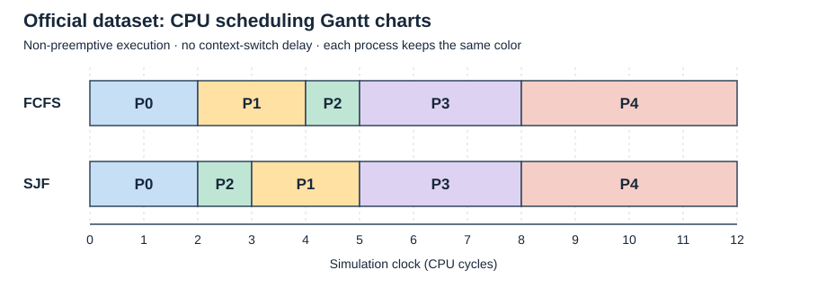

# Phase 2 — CPU Scheduling

[Overall project](../README.md) | [Phase 1 baseline](PHASE1_DESCRIPTION.md) | [Test evidence](evidence/phase2/README.md)

Phase 2 adds a CPU scheduler to the existing process manager. The scheduler answers two questions: which process gets the CPU next, and when will it finish? It calculates a schedule using the current records, then shows the execution order, start, finish, turnaround, and average turnaround.

The application is implemented and all **87 tests pass**. Official FCFS and SJF averages are **4.40** and **4.20** cycles. The original process-management features remain available. Execution transcripts, test explanations, and the completed 16-figure screenshot index are in [evidence/phase2](evidence/phase2/README.md).

## Suggested reading order for understanding the code

1. Start with **What changed, and what was reused** below. The existing manager still handles records; most new calculation work is in one file.
2. Read `schedule_fcfs()` in [scheduler.py](../scheduler.py). Follow the official table one row at a time: arrival, start, finish, then turnaround. Check why process 1 starts at 2 rather than at its arrival of 1.
3. Read `schedule_sjf()` in the same file. At clock 2, write down which jobs have arrived and compare their CPU requirements. This explains why process 2 runs before process 1. Then follow the clock to the next completion and repeat.
4. Read `average_turnaround()`. Add the turnaround values from either official table and divide by five. The two-decimal formatting happens later in the menu.
5. Find `run_scheduler_from_input()` in [main.py](../main.py), then `schedule_table()` in [cli_style.py](../cli_style.py). The first handles the user's choice and calls the calculation; the second displays the returned values.
6. Run the official example using **Try a run** below. Before viewing the answer, predict the next process and its finish time. Then try `data/phase2_idle.txt` and `data/phase2_nonpreemptive.txt` to check your understanding of waiting and running to completion.

A useful self-check is being able to explain why a process cannot start before arrival, why a later short job cannot interrupt a running job, and why running SJF does not change the data saved by the manager. The sections below explain each of these with examples.

## Requirements and scheduling rules

The assignment PDF awards 20 points for building on Phase 1, 20 for the result display, and 30 each for FCFS and SJF. The official test-data handout specifies these rules (both handouts are kept locally in `Assignment Specifications for Phase 2/`, which is not published to the repository):

- The algorithms are **non-preemptive**: once a process starts, it runs until it finishes. A shorter process arriving meanwhile waits.
- Ignore context-switch penalties in Phase 2. Moving from one process to the next adds no extra time.
- Assume plenty of memory. Keep the positive-memory field check, but do not limit the total or simulate allocating memory.
- All quantum values should match. The revised official records all use `3`. Quantum is still stored and checked, but these algorithms do not split CPU time into turns.

The five numeric rows were extracted unchanged into [data/phase2_official.txt](../data/phase2_official.txt). Load this numeric file in the application. The original handout also includes explanatory text and is provided as a reference document.

## What changed, and what was reused

The Phase 1 PCB already had `arrival_time` and `cpu_required`, including load/add/edit validation and display. Phase 2 uses those existing attributes. It does not add a second arrival field, change the six-field file format, or replace the process manager.

Compared with the submitted Phase 1 source, **two application files are new: `scheduler.py` and `data_paths.py`**. The scheduling calculations are the main Phase 2 addition; filename shortcuts are a separate interface improvement. Loading, viewing, adding, editing, removing, saving, file-picker pagination, colors, and overwrite protection were already present in Phase 1.

| File / function | Phase 2 work |
| --- | --- |
| [scheduler.py](../scheduler.py): `schedule_fcfs()` | New FCFS calculations. |
| `scheduler.py`: `schedule_sjf()` | New SJF calculations and temporary ready list. |
| `scheduler.py`: `average_turnaround()` | New average calculation with an empty-result check. |
| [main.py](../main.py): `run_scheduler_from_input()` | New algorithm menu and connection to the calculations/display. |
| `main.py`: `display_menu()` and `main()` | Add option 8, dispatch it, and update valid-choice feedback. Existing options remain. |
| [cli_style.py](../cli_style.py): `schedule_table()` | New result table with execution order and narrow-window fallback. |
| `cli_style.py`: `PROJECT_TITLE` | Update the visible heading to Phase 2. |
| [pcb.py](../pcb.py) | Clarify the memory comment; no behavioral change to the PCB. |
| [pcb_manager.py](../pcb_manager.py) | Reused without implementation changes. |
| [data_paths.py](../data_paths.py) | **New module:** shared filename shortcuts for manual loading and saving. |
| [file_picker.py](../file_picker.py), `main.py` load/save functions | **Modified:** use the new path helper, update filename prompts, and show the resolved destination. |
| [tests/test_scheduler.py](../tests/test_scheduler.py), [tests/test_scheduling_ui.py](../tests/test_scheduling_ui.py) | New algorithm and menu checks. |
| [tests/test_data_paths.py](../tests/test_data_paths.py) | **New test file:** six filename-shortcut tests. |
| Existing style/save/file-picker tests | Add schedule formatting checks, update the invalid-menu range to 1–8, and update the manual-path expectation. The editing and requirements test files are unchanged. |

The supporting Phase 2 additions are:

- **Data:** `data/phase2_official.txt`, `data/phase2_idle.txt`, `data/phase2_nonpreemptive.txt`, and `data/phase2_ties.txt` provide the official records and focused scheduling examples. `data/phase2_submission_demo.txt` preserves the edited records used in the screenshot save/reload demonstration; it is separate from the official input.
- **Documentation:** this Phase 2 guide is new; `PROJECT_DESCRIPTION.md` (now the repository `README.md`) covers both phases; `PHASE1_DESCRIPTION.md` preserves the Phase 1 walkthrough. The Phase 2 coversheet is prepared as a separate submission document.
- **Worked chart:** `docs/phase2-scheduling-gantt.svg` illustrates both official schedules. It accompanies the calculation walkthrough and is not generated by `main.py`.
- **Evidence:** `docs/evidence/phase2/` contains scheduling transcripts, replay inputs, a saved-data example, and case explanations. Sixteen actual Terminal screenshots and their captioned report document the Phase 2 runs in the separate submission evidence folder.
- **References:** the Phase 2 assignment folder supplies the current specification and test-data handout.

The test suite increased from **58 to 87 tests**: 14 scheduler tests, 7 scheduling-menu tests, 6 filename-shortcut tests, and 2 additional display tests. The application still uses only the Python standard library.

This keeps the same division of responsibilities as Phase 1: the manager keeps records, the menu asks for input, the scheduler calculates, and the style file controls appearance. No new package, class hierarchy, or custom queue is needed.

## Try a run

Open a terminal in the extracted project folder containing `main.py`, then run:

```bash
python3 main.py
```

1. Choose **1. Load**, then **M** for a manual path and enter `phase2_official`. The picker also lists it by name; its number can change as files are added.
2. Press Enter after loading, then choose **8. Run CPU scheduler**.
3. Choose **1** for FCFS. Read the table and average before pressing Enter.
4. Choose **8** again, then **2** for SJF. The same five process definitions are used.
5. Use **2. View** to see that their six fields and original order are unchanged.
6. Use **7. Exit** when finished.

Algorithm selection accepts surrounding spaces, retries invalid choices, and accepts `C` or `c` to cancel. If the collection is empty, it asks the user to load or add records first. There is no numerical average for an empty run.

Each run is fresh. Editing a CPU value or arrival affects the next result; removing a process removes it from the next schedule. Saving after a run writes process definitions only, not start/finish times.

## Filename convenience update

Manual **Load → M** and **Save** now share `resolve_data_path()` in `data_paths.py`. For example, `phase2_official`, `phase2_official.txt`, `data/phase2_official`, and `data/phase2_official.txt` all select the same project data file. The helper supplies the default folder and missing `.txt` extension before the existing file operations run. Explicit paths and extensions remain supported.

This is a Phase 2 interface improvement to the inherited Phase 1 load/save features. The manager's exact-path API, data validation, numbered picker, and overwrite protection remain intact. See the [overall guide's examples and manual checks](../README.md#easier-manual-loading-and-saving). Six new automated tests use temporary folders and check actual save/load behavior, not just string conversion.

## Data structures in plain language

A **PCB** groups the six values for one process. The manager holds a Python **list** of PCBs. A list keeps items in order; the manager's order is file/addition order, not scheduling order.

The scheduler uses its own temporary lists. They refer to the same PCB objects, but can be sorted or shortened without changing the manager's list. The scheduler only reads the fields, so it does not change the original objects either.

A result is another list, this time holding one **dictionary** per completed process. A dictionary names its values, such as `row["finish_time"]`, instead of requiring the reader to remember a numbered position. For example:

```python
{
    "process_id": 1,
    "arrival_time": 1,
    "cpu_required": 2,
    "start_time": 3,
    "finish_time": 5,
    "turnaround_time": 4
}
```

This says process 1 arrived at 1, began running at 3, and finished at 5. It spent four cycles in the system. These integers are copied into a result row, so later editing a PCB does not change a result that was already calculated. The position in the result list supplies the displayed Order column.

The **clock** is just an integer local to the current run. Advancing it means calculating the next time; the program does not sleep for real seconds. Each new run starts its clock at zero.

### Process states and ready queues

| State or idea | Meaning in this simulation |
| --- | --- |
| Not yet arrived | A process whose arrival time is later than the current clock cannot be selected yet. |
| Ready | A process has arrived and is waiting for the CPU. SJF collects these processes in `ready_processes`. |
| Running | The selected process uses the CPU from its calculated start to finish. |
| Finished / terminated | A result row records its completion; it is no longer selected in this run. |

A ready queue is the group waiting to use the CPU. It does not require a custom queue class here. FCFS follows the arrival-sorted list, while SJF checks the available jobs each time the CPU becomes free. The manager still retains finished process definitions so the user can view them or run another comparison.

The supplied records have no I/O events, so there is no blocked-for-I/O queue or process migration simulation. The working lists, current selection, and completed result rows represent the scheduling states without storing a separate state field in each PCB.

## Choosing the next process

### FCFS: first arrival goes first

`sorted()` creates a new list ordered by arrival time. For each process, the start is whichever is later: the current clock or its arrival. The process then runs for all of its CPU requirement, and its finish becomes the new clock.

Equal arrivals keep the current collection order. Python calls this a stable sort: equal sorting values do not swap their original order. A process ID is not used to break the tie.

### SJF: shortest of the jobs that are ready

`remaining` starts as a copy of the process list. At each choice, the algorithm collects the remaining jobs with `arrival_time <= clock` into `ready_processes`. It selects the one needing the least CPU time.

If nobody is ready, the clock jumps to the next arrival and the loop checks again. Otherwise, the chosen process runs to completion, its result is recorded, and it is removed from `remaining`. The next loop rebuilds the ready list because more jobs may have arrived during that run.

For equal CPU requirements, choose earlier arrival; if those also match, keep file/addition order. These tie rules are project choices; the assignment does not specify tie-breaking.

Sorting the entire input once by CPU requirement would be wrong: the shortest job might not have arrived. Checking each cycle is unnecessary too; the only important times here are arrivals when idle and process completions.

These small datasets do not need a faster queue implementation. FCFS sorts once. SJF repeatedly scans a short list, which keeps the selection rule easy to follow.

## Timing calculations

Suppose process 1 arrives at clock 1, waits until clock 3, and needs two CPU cycles. It finishes at `3 + 2 = 5`. Its turnaround is `5 - 1 = 4`, because turnaround includes both the waiting and CPU time.

```text
start = later of current clock and arrival (FCFS)
start = current clock for the selected ready job (SJF)
finish = start + CPU required
turnaround = finish - arrival
average turnaround = sum of all turnaround times / number of processes
```

An interval from 2 to 4 is two cycles; do not add one to the finish. A job arriving exactly when another completes is ready for the next choice. If a lone job arrives at 5 and runs for 3, it starts at 5, finishes at 8, and has turnaround 3—not 8. The earlier idle time happened before it arrived.

`average_turnaround()` returns `None` for an empty schedule, avoiding division by zero. Otherwise, normal division retains fractions. The menu formats the displayed average to two decimal places.

## Official results

These are hand-calculated expectations that the program and tests match under the rules in the supplied Phase 2 handout.

### FCFS: 0 → 1 → 2 → 3 → 4

| Order | ID | Arrival | CPU required | Start | Finish | Turnaround |
| ---: | ---: | ---: | ---: | ---: | ---: | ---: |
| 1 | 0 | 0 | 2 | 0 | 2 | 2 |
| 2 | 1 | 1 | 2 | 2 | 4 | 3 |
| 3 | 2 | 2 | 1 | 4 | 5 | 3 |
| 4 | 3 | 3 | 3 | 5 | 8 | 5 |
| 5 | 4 | 3 | 4 | 8 | 12 | 9 |

Average: `(2 + 3 + 3 + 5 + 9) / 5 = 4.40` cycles.

### SJF: 0 → 2 → 1 → 3 → 4

| Order | ID | Arrival | CPU required | Start | Finish | Turnaround |
| ---: | ---: | ---: | ---: | ---: | ---: | ---: |
| 1 | 0 | 0 | 2 | 0 | 2 | 2 |
| 2 | 2 | 2 | 1 | 2 | 3 | 1 |
| 3 | 1 | 1 | 2 | 3 | 5 | 4 |
| 4 | 3 | 3 | 3 | 5 | 8 | 5 |
| 5 | 4 | 3 | 4 | 8 | 12 | 9 |

Average: `(2 + 1 + 4 + 5 + 9) / 5 = 4.20` cycles.

At clock 2, process 2 arrives just as process 0 finishes. It needs one cycle, less than process 1's two, so SJF selects it next. This lowers the average for this example, but process 1 actually waits longer. A lower average does not mean every individual job finishes sooner.

## Worked scheduling timelines and performance measures

This section walks through the official dataset to show how the scheduling order and timing values are calculated. The Gantt charts and calculation tables are documentation examples. Running `main.py` displays a text schedule with execution order, start, finish, turnaround, and average turnaround; it does not generate these charts or display waiting time and throughput. The schedule values below match the application's results.

### Gantt charts apply to both algorithms

A scheduling Gantt chart shows which process occupies the CPU during each interval. It can illustrate FCFS, SJF, or other scheduling algorithms. The algorithm determines the order; the chart displays that order over time.



[Open the standalone chart](phase2-scheduling-gantt.svg). Both rows use the same clock scale. `P0` means process ID 0. The official data has no idle intervals, and context switches add no time in this phase. For a plain-text reading of the same boundaries:

```text
FCFS: 0 -- P0 -- 2 -- P1 -- 4 -- P2 -- 5 -- P3 -- 8 -- P4 -- 12
SJF:  0 -- P0 -- 2 -- P2 -- 3 -- P1 -- 5 -- P3 -- 8 -- P4 -- 12
```

The text spacing is schematic; the SVG bar widths are proportional to duration. Read each interval as start-inclusive and finish-exclusive: P0 occupies `[0, 2)`, so it uses two cycles and the next process can start at 2.

### Deriving the order before running the program

The official input gives arrival times `0, 1, 2, 3, 3` and CPU requirements `2, 2, 1, 3, 4` for P0 through P4.

For **FCFS**, arrival order is P0, P1, P2, P3, P4. P3 and P4 arrive together, so the documented tie rule keeps their file order. Start P0 at 0 and add its two CPU cycles to finish at 2. P1 has already arrived, so it starts at 2 and finishes at 4. Continuing this calculation gives boundaries `0, 2, 4, 5, 8, 12`, as shown in the official results table above.

For **SJF**, reconsider the available unfinished jobs whenever the CPU becomes free:

| Clock | Ready processes (CPU cycles required) | Selection and execution interval |
| ---: | --- | --- |
| 0 | P0 (2) | Only P0 is ready; run P0 from 0 to 2. |
| 2 | P1 (2), P2 (1) | P2 is shortest; run P2 from 2 to 3. |
| 3 | P1 (2), P3 (3), P4 (4) | P1 is shortest; run P1 from 3 to 5. |
| 5 | P3 (3), P4 (4) | P3 is shortest; run P3 from 5 to 8. |
| 8 | P4 (4) | Run P4 from 8 to 12. |

P2 is eligible at exactly clock 2. It could not be selected at clock 0 because it had not arrived. A job that arrives while another is running waits until that job finishes: these algorithms are non-preemptive.

### Turnaround and waiting time are different

Let `A` be arrival, `B` be CPU required (the CPU burst), `S` be start, and `F` be finish. All four are measured in simulated CPU clock cycles.

| Measure | Formula for this implementation | Meaning |
| --- | --- | --- |
| Finish | `F = S + B` | The clock reading when the process completes. |
| Turnaround | `T = F - A` | Total elapsed time in the system, including waiting and running. |
| Waiting | `W = S - A = T - B` | Time ready for the CPU before execution begins. |
| Average turnaround | `sum(T) / number of processes` | Mean time from arrival to completion. |
| Average waiting | `sum(W) / number of processes` | Mean time spent waiting for the CPU. |

The waiting formula applies directly here because each process has one uninterrupted CPU burst, with no I/O or context-switch delay. More complex simulations must account for their additional states and intervals. The application displays turnaround and average turnaround; waiting and throughput are worked out in this documentation as supplemental measures.

Using the start and finish times from the official tables:

| Process | Arrival | CPU required | FCFS waiting (`S - A`) | FCFS turnaround (`F - A`) | SJF waiting (`S - A`) | SJF turnaround (`F - A`) |
| --- | ---: | ---: | --- | --- | --- | --- |
| P0 | 0 | 2 | `0 - 0 = 0` | `2 - 0 = 2` | `0 - 0 = 0` | `2 - 0 = 2` |
| P1 | 1 | 2 | `2 - 1 = 1` | `4 - 1 = 3` | `3 - 1 = 2` | `5 - 1 = 4` |
| P2 | 2 | 1 | `4 - 2 = 2` | `5 - 2 = 3` | `2 - 2 = 0` | `3 - 2 = 1` |
| P3 | 3 | 3 | `5 - 3 = 2` | `8 - 3 = 5` | `5 - 3 = 2` | `8 - 3 = 5` |
| P4 | 3 | 4 | `8 - 3 = 5` | `12 - 3 = 9` | `8 - 3 = 5` | `12 - 3 = 9` |

```text
FCFS average waiting    = (0 + 1 + 2 + 2 + 5) / 5 = 10 / 5 = 2.00 cycles
SJF average waiting     = (0 + 2 + 0 + 2 + 5) / 5 =  9 / 5 = 1.80 cycles
FCFS average turnaround = (2 + 3 + 3 + 5 + 9) / 5 = 22 / 5 = 4.40 cycles
SJF average turnaround  = (2 + 4 + 1 + 5 + 9) / 5 = 21 / 5 = 4.20 cycles
```

These sums list processes in ID order for easy comparison; changing the order of the terms does not change the average. As a cross-check, average CPU required is `12 / 5 = 2.40` cycles. Adding this to average waiting gives average turnaround: `2.00 + 2.40 = 4.40` for FCFS and `1.80 + 2.40 = 4.20` for SJF.

### Throughput and the observation interval

Throughput is the number of completed processes divided by the elapsed time being measured. Its units here are **processes per simulated CPU cycle**, not cycles per process or the Python program's real execution speed. Always state the observation interval, especially when a dataset includes idle time.

For this comparison, measure from simulation clock **0 through the final completion at 12**. Both schedules complete all five processes in that interval:

```text
Throughput = 5 / (12 - 0) = 5/12 ≈ 0.417 processes per cycle
```

The CPU does `2 + 2 + 1 + 3 + 4 = 12` cycles of work with no idle gaps in either official schedule. SJF improves average waiting and turnaround here, but both algorithms have the same throughput over the complete run. P2 finishes two cycles earlier under SJF, while P1 finishes one cycle later; the last completion remains at 12.

Idle time must stay visible when it is inside the observation interval. For `data/phase2_idle.txt`, both algorithms produce `Idle [0,5) → P1 [5,7) → Idle [7,12) → P2 [12,13)`. Measured from clock 0 to 13, throughput is `2/13 ≈ 0.154` processes per cycle. Both jobs start at arrival, so their waiting times are zero, even though the overall timeline includes idle time. Their average turnaround is `(2 + 1) / 2 = 1.50` cycles. Measuring instead from the first arrival at 5 would give throughput `2/(13 - 5) = 0.25`; that is a different observation interval and must be labeled accordingly.

## Tests and observed evidence

Run `python3 -m unittest discover -s tests -v` from the project root. The 87 passing tests include the 58-test Phase 1 baseline and 29 new tests: 14 scheduler tests, 7 menu/integration tests, 2 display tests added to the existing style suite, and 6 filename-shortcut tests.

The tests compare explicit expected rows and averages. They also check that each input process runs once, intervals do not overlap, no job starts before arrival, and the original PCB identities, six values, and order survive repeated runs and saving.

| Case | Expected and observed behavior | Evidence |
| --- | --- | --- |
| Official FCFS | Rows above; average 4.40. | [Actual CLI output](evidence/phase2/official_fcfs.txt) |
| Official SJF | Rows above; average 4.20. | [Actual CLI output](evidence/phase2/official_sjf.txt) |
| Idle gaps | `phase2_idle.txt`: jobs run 5–7 and 12–13; turnarounds 2 and 1; average 1.50 for both algorithms. | [Actual CLI output](evidence/phase2/idle.txt) |
| Non-preemption | `phase2_nonpreemptive.txt`: SJF runs IDs 10, 30, 20 during 0–8, 8–9, 9–11. Turnarounds 8, 7, 10; average 8.33. | [Actual CLI output](evidence/phase2/nonpreemptive.txt) |
| Ties | `phase2_ties.txt`: SJF order 30, 20, 10, 40; turnarounds 2, 4, 5, 6; average 4.25. | [Actual CLI output](evidence/phase2/ties.txt) |
| Invalid arrival edit | Attempt arrival −1 for process 0, cancel after rejection, then FCFS still averages 4.40. | [Actual CLI output](evidence/phase2/invalid_edit.txt) |
| Edit/save/reload | Change process 0 CPU from 2 to 1. FCFS turnarounds become 1, 2, 2, 4, 8; average 3.40 before and after saving/reloading. | [Actual CLI output](evidence/phase2/edit_save_reload.txt) |

Additional automated cases cover empty input, one late arrival, all arrivals equal, unsorted records, a very large idle gap, no memory/penalty/quantum influence on timing, added/removed processes, changed arrival, cancellation, and menu feedback. Interactive terminal checks also covered the normal wide table, Enter pauses, unchanged records after both official runs, and a narrow, 35-column display with colors disabled.

The earlier `.txt` evidence files are program transcripts. They predate the filename-shortcut update, so some prompts differ from the current interface; their scheduling results are unchanged. The separate screenshot report shows the current interface in 16 actual Terminal captures with actions, expected results, and observed-result captions. See the [evidence index](evidence/phase2/README.md) for filenames and reproduction details. The screenshot save/reload demonstration created `data/phase2_submission_demo.txt`; the earlier transcript demonstration used [evidence/phase2/edited_processes.txt](evidence/phase2/edited_processes.txt). Neither changed the official input data.

## Architecture summary

The PCB keeps one process's six values together, and the manager stores a list of those records. The menu sends that list to the chosen scheduling function. The scheduler keeps its own working list and clock, chooses a process, calculates when it finishes, and adds a result row. FCFS chooses by arrival order; SJF chooses the shortest currently available job. The style module displays the rows and the menu shows the average. Keeping the result separate means the original records can be reused for another run or saved unchanged.

## Example walkthrough

1. Show the six PCB fields and identify arrival and CPU required as the values the scheduler uses.
2. Load `data/phase2_official.txt` and run FCFS. Explain one turnaround as finish minus arrival.
3. Run SJF without reloading. Explain why process 2 runs before process 1 at clock 2.
4. Load `data/phase2_nonpreemptive.txt`. Explain why process 10 still finishes at 8 even though shorter jobs arrive meanwhile.
5. Load `data/phase2_idle.txt` to show that the CPU waits for an arrival instead of starting early.
6. Return to the official set, edit process 0's CPU to 1, and rerun FCFS to show average 3.40. Save to a separate filename and reload if demonstrating preservation.
7. Point to the small scheduler module and its comments. Explain ready/running/finished using the temporary lists and result rows.

The [test evidence guide](evidence/phase2/README.md) provides the inputs, expected results, and completed screenshot index for these demonstrations.

## Phase 2 submission package (historical)

> This section records how the Phase 2 submission ZIP was packaged. Its paths describe that ZIP, not the current repository layout.

The Phase 2 instructions and revised official test-data handout are kept locally in `Assignment Specifications for Phase 2/`, which is not published to the repository.

The application follows the handout's rules: matching quantum values, non-preemptive algorithms, ignored switch penalties, and plenty of memory.

The [evidence index](evidence/phase2/README.md#screenshot-checklist) lists the 16 captured terminal screenshots. Their completed report includes actions, expected results, and observed results. The worked charts explain the calculations; the screenshots document actual application runs.

The intended outer submission ZIP has four deliverables, following the Phase 1 submission structure:

1. **Coversheet List Of Contributors.pdf:** the standalone author/contributor statement.
2. **QD_Phase 2/** or **QD_Phase 2.zip:** the complete runnable project, with the contents listed below. Preserve the folder structure so data files, tests, and documentation links work after extraction.
3. **Visual Showcase and Documentation/**: the completed `Phase 2 Screenshot Documentation Report.pdf` and a `Screenshots/` folder containing the actual captures. The report labels each figure and explains its input, expected result, observed result, and purpose.
4. **Phase 2 Project Overview.pdf:** the standalone explanation of the PCB, main data structures, architecture, and scheduling implementation.

The screenshot report is complete in both Word and PDF form. Keep editable Word files as working copies and use the final PDFs for submission. The standalone coversheet belongs outside the runnable project; omit its working Markdown copy, `PHASE2_COVERSHEET.md`, from the code package. Screenshot images and their report belong together in `Visual Showcase and Documentation/` and need not be duplicated inside the code package.

#### Recommended code-package contents

| Include | Reason |
| --- | --- |
| All seven application files: `main.py`, `pcb.py`, `pcb_manager.py`, `scheduler.py`, `cli_style.py`, `file_picker.py`, and `data_paths.py` | These files work together to run the application. |
| `PROJECT_DESCRIPTION.md`, `PHASE1_DESCRIPTION.md`, and `PHASE2_DESCRIPTION.md` | Startup instructions, the retained Phase 1 features, and the Phase 2 explanation. |
| `tests/` containing the eight `test_*.py` files | Lets the reader rerun the 87 automated tests. Omit its cache folder. |
| `data/` containing the nine files listed below | Supplies the test inputs and documented examples. |
| `docs/phase2-scheduling-gantt.svg` | The Phase 2 guide embeds and links to this worked chart. |
| `evidence/phase2/` | Contains the linked test explanations, text transcripts, replay inputs, and saved-data example. It supplements the separate screenshot report. |
| Both `Assignment Specifications for Phase 1/` and `Assignment Specifications for Phase 2/`, each with its PDF and test-data TXT file | Keeps the original requirements and data references available through the guides' links. These are reference materials, not runtime dependencies. |

Keep these files in `data/`:

- `dataset1.txt`, `dataset2.txt`, and `dataset3.txt`: the original Phase 1 sets, also used by automated tests.
- `invalid_data_test.txt`: the deliberately malformed file described in the Phase 1 guide.
- `phase2_official.txt`: the unchanged numeric records from the Phase 2 handout.
- `phase2_idle.txt`, `phase2_nonpreemptive.txt`, and `phase2_ties.txt`: the additional scheduling cases used by tests and evidence.
- `phase2_submission_demo.txt`: the saved result of the screenshot editing demonstration, with process 0's CPU requirement changed to 1.

The older saved examples `phase1_demo.txt`, `phase1_demo2.txt`, `saved_processes.txt`, `saved_processes2.txt`, and `test2.txt` can be left out of the submission copy. The automated tests and documented Phase 2 runs do not load them. Earlier captures may show them in the file picker; the picker numbers can change when files are omitted, so the walkthroughs select files by name.

Leave `phase2_plan.md`, `PHASE2_COVERSHEET.md`, and the duplicate `screenshots/` folder out of the code package. Also exclude all `__pycache__/` folders, `.pyc` files, `.DS_Store` files, `__MACOSX/` folders, Word lock files whose names begin with `~$`, and temporary placeholder notes. Python recreates its cache files when needed; they are not part of the source. Apply these exclusions to the submission copy while keeping any useful working materials in the development folder.
